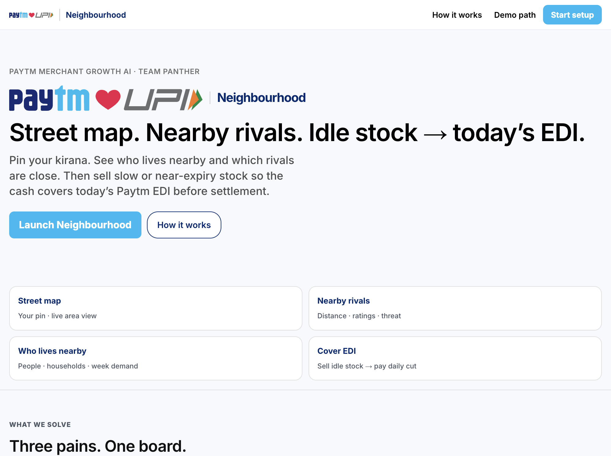
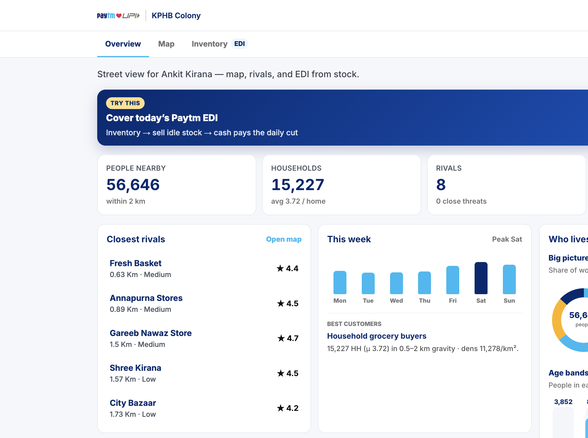
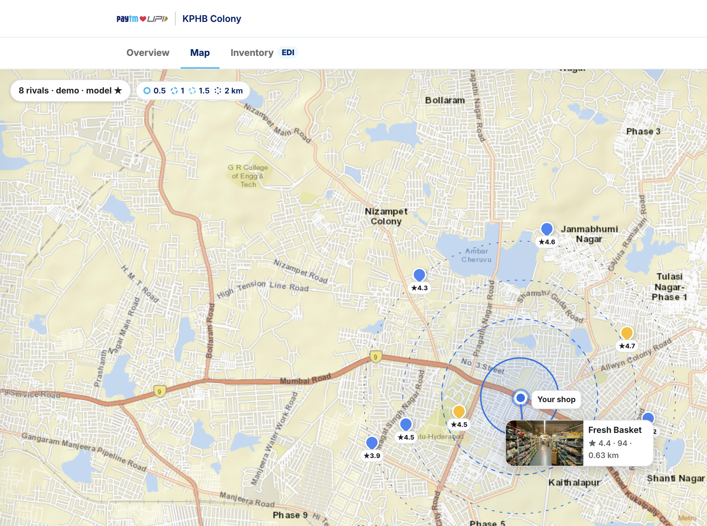
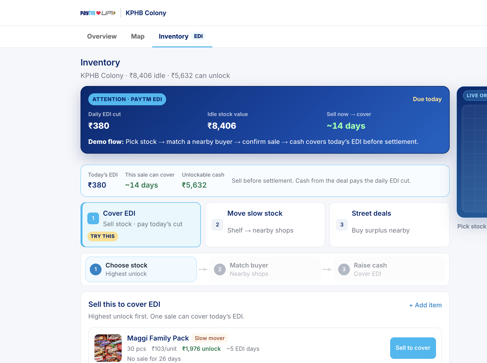

# Paytm Neighbourhood

**Street map. Nearby rivals. Idle stock → today’s EDI.**

Team Panther · Paytm Merchant Growth AI hackathon



---

## The problem

Kirana merchants face three linked pains every day:

1. **Don’t know the street** — who lives nearby, which rival is winning, what to stock this week  
2. **Idle stock locks cash** — slow / near-expiry SKUs sit while working capital is frozen  
3. **EDI still hits daily** — Paytm’s daily loan cut falls due even when the wrong stock sits idle  

---

## What we built

**Neighbourhood** helps merchants:

- Pin the shop on a **live street map** with rivals  
- See people / households nearby and weekly demand  
- **Sell idle stock to nearby buyers** so cash can **cover today’s Paytm EDI** before settlement  

### Hero flow — Cover EDI

1. Pick ageing stock (highest unlock first)  
2. Match a nearby buyer  
3. Confirm sale → cash covers EDI days  







---

## Demo login

| Field | Value |
|--------|--------|
| Mobile | `1122334455` |
| OTP | `123456` |

Then **Allow location** (or continue with demo pin). Map opens by default → open **Inventory / EDI** → **Cover EDI**.

---

## Run locally

```bash
cd dashboard
npm install
npm run dev
```

Open **http://127.0.0.1:5173**

Optional env (see `dashboard/.env.example`):

- `SARVAM_API_KEY` — Ask chat / translate  
- `GOOGLE_PLACES_API_KEY` — live rival ratings (optional)  

---

## Pitch deck

`out/Paytm_Neighbourhood_Team_Panther.pptx` — 6 slides  

1. Title  
2. Three problems we solve  
3. Dashboard + map (know your streets)  
4. Inventory exchange + EDI  
5. How merchant life gets easier  
6. Thank you  

```bash
python3 build_deck.py
```
